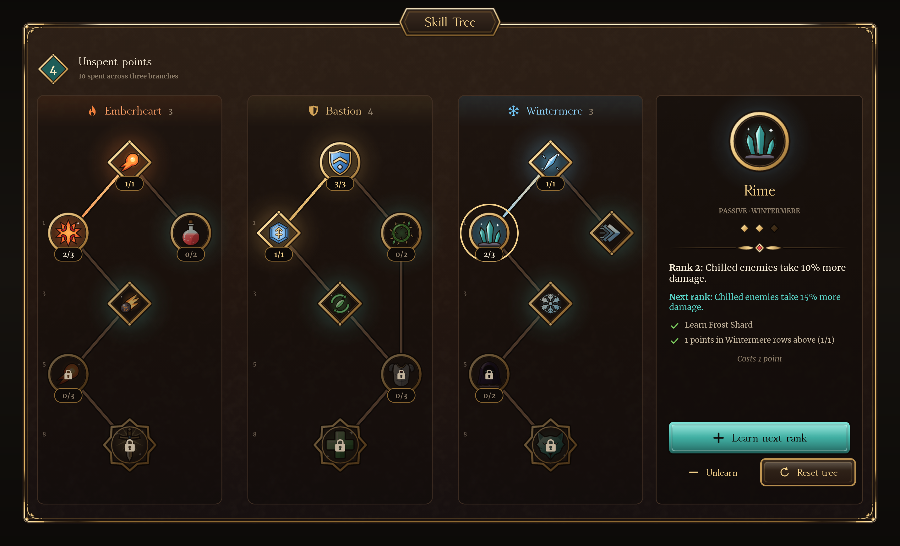

# Vellum · Stylized Fantasy RPG UI Component Library

A Roblox UI component library for fantasy RPG interfaces, built with native GUI objects and Luau.
It is **a UI library, not a game**: there is no world, character, combat, networking, DataStore or economy.
Every component runs on local example state, and its interactions (drag-and-drop, filtering, skill allocation,
crafting, purchases and so on) are real UI logic that only changes the UI.

The place opens straight into a **component gallery**: a neutral shell for browsing, driving and capturing each
component in isolation.

## Visual identity

An illuminated grimoire: dark umber leather panels with gilt filigree frames, parchment cards in iron-gall ink,
jewel-toned rarity (common → mythic) and a single arcane teal for magic and keyboard focus.
Type: Accanthis ADF (display), Merriweather (body, numbers, italic lore), Grenze Gotisch (rare hero moments).
All 2D art is original and generated from source (`art/`): 56 painted item and skill icons, 44 glyphs, gilt
frames, node frames, seal, ribbon, paperdoll silhouette, and tileable leather and parchment textures.

## Open the gallery

1. `python tools/build_place.py` builds `place/Vellum_RPG_UI_Library.rbxlx` from `src/`.
2. Textures: `python art/install_local.py` copies the atlases into Studio's content folder
   (`rbxasset://textures/vellum/...`). This works in Studio on this machine. To ship the place elsewhere, upload the
   four PNGs in `art/out/`, put their ids in `art/asset_ids.json`
   (`{"icons": "rbxassetid://…", "chrome": …, "leather": …, "parchment": …}`) and run `art/build_atlas.py` again.
3. Open the `.rbxlx` in Roblox Studio and press **Play**. No character spawns (`CharacterAutoLoads = false`).

**Gallery controls**: sidebar for families and specimens · PgUp/PgDn to switch specimen · Ctrl+R to reset its
example state · F8 for capture mode · header chips for stage width (Fit / 1024 / 720), motion on/off, capture and
reset · the bottom bar runs the specimen's state actions (for example "Drag slot 1 → 3", "Learn Rime ×2", "Showcase states").
The sidebar footer shows live scopes, listeners and instances (leak check).

## Components (24 specimens, 7 families)

| Family | Pieces |
|---|---|
| Buttons & Controls | Button (primary, secondary, ghost, danger, arcane, ink × default/hover/pressed/focused/selected/disabled/loading, three sizes, key hints), icon button, toggle, checkbox, radio, segmented, bookmark tabs, slider (drag + keyboard), dropdown (overlay, keyboard), search |
| Inventory | Satchel: drag-and-drop with stack merging, click / Enter pick-and-place, category filter, search, sort, context menu (use, equip, split, junk, discard with confirmation), comparison tooltips · item cards · slot states |
| Character & Equipment | Character card (crest portrait, XP ring), vitals with damage trail, XP and level-up, status effects with live radial timers and stacks, equipment paperdoll with item chooser, attribute allocation (commit / undo), derived stats |
| Skills & Abilities | Skill tree (three branches, prerequisites, row gates, ranks, learn / unlearn validation, animated paths, reset with confirmation) · ability bar (keybinds, cooldown sweeps, GCD, mana cost, out-of-mana, toggle, locked) · ability cards |
| Quests & Progression | Quest journal (tabs, parchment detail, track, abandon, turn-in) · quest cards · tracker widget · achievements · level-up presentation · quest-complete notice |
| Crafting & Commerce | Crafting station (recipes, have / need, quantity, timed progress, cancel, missing materials) · vendor (buy / sell, stock, discounts, sold out, unaffordable) · purchase dialog (quantity, balance after purchase) |
| Feedback & Overlays | Toasts (six tones, stacking, timers) · modal dialog (focus trap, Esc / Enter) · loot reveal · progress rings, loading rune, tags, currency counters, tooltip, context menu |

## Architecture (`src/ReplicatedStorage/Vellum`)

- `Theme`: every colour, type role, spacing, size, motion and z-layer token.
- `Core/Scope`: lifecycle. Components add connections, instances, tweens and threads to a scope and are
  released with one `:Destroy()`.
- `Core/Store`: predictable local state (`set` patches, `Store.NONE` removes, `subscribe`, `reset`).
- `Core/Interact`: one hover / press / focus / selected / disabled / loading state machine for every pressable
  control. Keyboard focus uses `GuiService.SelectedObject` with each control's own focus treatment.
- `Core/Layers`: the overlay for tooltips, menus, modals, toasts and drag ghosts, correct inside a `UIScale`.
- `Core/DragDrop`, `Core/Motion` (one tween per channel, reduced motion, pause), `Core/Create` (builder).
- `Components/*`: Surface (panel, parchment, divider), Button, Controls, Feedback, Slot, ItemCard.
- `Widgets/*`: Inventory, Character, SkillTree, Abilities, Progression, Commerce. Rules are pure functions
  (`Inventory.move/sort/view`, `SkillTree.canLearn/canUnlearn`, `Commerce.maxCraftable`) covered by tests.
- `Data/*`: local example items, character, skills, quests and recipes.

Component API: `X.new(scope, props) → handle` with `.Instance`, setters and callbacks in props.

`VellumGallery/`: Registry (specimens by family), Stage (isolated canvas, fit or tiled), App (gallery shell),
Specimens (one module per family), Captures (portfolio capture list).

## Verification

- `tools/tests.luau`: 12 unit tests (Store, Scope, Signal, inventory move / merge / filter / sort, skill-tree rules,
  crafting, derived stats). Run in Studio after a sync.
- Play-mode checks with real mouse and keyboard input: drag-and-drop, context menu → confirm → Esc, skill learn,
  vendor purchase with the quantity slider, crafting, toggles and slider by keyboard.
- Leak check: 72 specimen switches leave the same scope, listener and instance counts.

## Development loop

`python tools/build_place.py --serve` serves `src/` on `127.0.0.1:34873`. In Studio (command bar or MCP), run
`loadstring(game:GetService("HttpService"):GetAsync("http://127.0.0.1:34873/sync.luau", true))()` to apply it, and
`tools/preview.luau` to render a specimen in Edit mode.

## Captures

`captures/*.png` are real renders of the running components, each isolated on a neutral canvas at 2× scale.
`VellumBridge:Invoke("batch")` walks `VellumGallery/Captures` in capture mode: every specimen is rendered in
tiles with index markers on a magenta matte, and `tools/capture/batch.py <geometry.json> captures` grabs the
Studio window with PrintWindow (never the desktop) and stitches the tiles.
